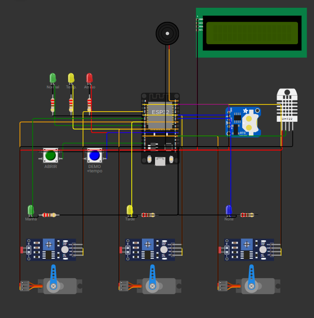

> **Global Solution 2026.2 | CitizenTech** · **Disciplina:** Edge Computing & Computer Systems

# 💊 Memora · Caixa de Remédios Inteligente

Simulação no Wokwi da caixa do Memora, a parte que fica na casa da pessoa idosa e lembra, protege e avisa na hora de cada remédio.

## 📌 Descrição do projeto

Para quem tem Alzheimer, o remédio traz duas dúvidas todos os dias: *"já está na hora?"* e *"será que eu já tomei?"*. Esquecer a dose atrapalha o tratamento, e tomar duas vezes pode ser perigoso. Enquanto isso, a família, muitas vezes longe, fica sem saber o que aconteceu.

O **Memora** nasceu para responder a essas perguntas. A solução completa reúne a **caixa de remédios inteligente**, que fica ao lado da pessoa, e a Central do Cuidador, onde a família acompanha cada dose.

Este repositório traz a **caixa**, construída com ESP32. Na hora de cada dose, ela libera **somente o compartimento certo** (manhã, tarde ou noite), acende a luz desse compartimento e toca um lembrete. Os outros continuam travados, o que evita a dose dobrada. Um sensor de luz percebe quando o remédio sai da caixa. Se ninguém retira a dose, a caixa insiste e, depois de 20 minutos, avisa o cuidador. Ela também mede a **temperatura** do local, porque o calor pode tirar a eficácia dos remédios.

Toda a decisão acontece no próprio ESP32, com os horários guardados no relógio da caixa. Por isso, ela **funciona mesmo sem internet**: a dose certa nunca depende do Wi-Fi.

O objetivo é simples: que a pessoa idosa tome o remédio certo, na hora certa, com mais autonomia, e que a família só precise agir quando algo realmente sair do lugar.

> **Importante:** a caixa registra a *retirada* do remédio, não confirma que ele foi ingerido.

---

## ⏰ Horários e limites

| Parâmetro | Valor | Por quê |
|---|---|---|
| Doses | 08:00 (manhã), 14:00 (tarde), 20:00 (noite) | Um compartimento por período do dia |
| Lembrete | 10 min após o horário | Dá tempo para a pessoa chegar até a caixa antes de insistir |
| Dose atrasada | 20 min após o horário | Mesmo critério do painel e do relatório: até 20 min conta como "no horário" |
| Limite da dose | 60 min após o horário | Depois disso, o compartimento trava para evitar dose fora de hora |
| Temperatura máxima | 30 °C | Acima disso, muitos remédios perdem eficácia (o valor certo depende da bula) |

---

## 🔴 Lógica de estados

A caixa funciona como uma **máquina de 7 estados**:

| Estado | Quando acontece | LEDs | Buzzer | Display |
|---|---|---|---|---|
| `AGUARDANDO` | Nenhuma dose no momento | 🟢 Verde fraco | Desligado | Hora, temperatura e próxima dose |
| `HORA_DA_DOSE` | Chegou o horário da dose | LED do compartimento aceso | Melodia de lembrete | `HORA DO REMEDIO!` |
| `LEMBRETE` | 10 min sem retirada | LED do compartimento piscando devagar | Melodia a cada 5 min | `Retire o remedio` + minutos |
| `DOSE_ATRASADA` | 20 min sem retirada | 🔴 Vermelho + compartimento piscando rápido | Alarme a cada 10 min | `DOSE ATRASADA!` + minutos |
| `DOSE_RETIRADA` | O sensor confirmou a retirada | 🟢 Verde forte | Som de confirmação | `Remedio retirado` + hora |
| `FORA_DE_HORA` | Tentativa de abrir fora do horário | 🔴 Vermelho piscando | Bipe | `Fora do horario!` + próxima dose |
| `ARMAZENAMENTO_RUIM` | Temperatura média acima de 30 °C | 🟡 Amarelo | Alerta de calor | `ALERTA TEMPERAT.` + valor |

**Avisos ao cuidador:** nos estados `DOSE_ATRASADA`, `FORA_DE_HORA` (com aviso de possível dose duplicada se a dose já foi retirada) e `ARMAZENAMENTO_RUIM`, a caixa monta a mensagem de WhatsApp para o cuidador e mostra no Serial Monitor. O envio real pelo MQTT já está preparado no código, mas fica desligado nesta versão (`MQTT_LIGADO = false`).

**Leituras confiáveis:**

- **Suavização:** o LDR e o DHT22 usam a média das últimas 5 leituras. O compartimento só muda de "cheio" para "vazio" (e vice-versa) depois de 8 leituras seguidas, cerca de 1,6 s, para que uma sombra passageira não seja confundida com a retirada do remédio.
- **Leitura inválida:** se o DHT22 devolver `NaN`, a leitura é ignorada, o display mostra `T:ERRO` e o estado não muda. Quando o sensor volta, a caixa registra `SENSOR_OK`.
- **Histerese:** o alerta de temperatura entra acima de 30 °C e só sai abaixo de 29 °C, para não ficar ligando e desligando.
- **Sem `delay()`:** todo o tempo é controlado com `millis()`, inclusive as melodias do buzzer, para que a caixa nunca deixe de ler os sensores.

---

## 🔌 Circuito



> Simulação montada no **Wokwi** com ESP32. Cada compartimento tem um **servo** (a trava), um **LDR** (que percebe se o remédio está lá) e um **LED** (que mostra qual dose tomar). O RTC DS1307 guarda a hora, o DHT22 mede a temperatura e o LCD 16x2 mostra as mensagens.

🔗 [Acessar simulação no Wokwi](https://wokwi.com/projects/480810351690378241)

[](https://youtu.be/SvAzF9D5hhs?si=AlnR1PwxQ8Fv_h8w)

### Componentes

| Componente | Quantidade | Pino no ESP32 |
|---|---|---|
| ESP32 DevKit V1 | 1 | — |
| Servo motor (trava manhã / tarde / noite) | 3 | GPIO 18 / 17 / 14 |
| Módulo LDR (manhã / tarde / noite) | 3 | GPIO 34 / 35 / 36 |
| LED do compartimento (verde / amarelo / azul) | 3 | GPIO 32 / 33 / 19 |
| LED Verde "Normal" | 1 | GPIO 25 |
| LED Amarelo "Temp." | 1 | GPIO 26 |
| LED Vermelho "Atraso" | 1 | GPIO 27 |
| Resistores 220 Ω | 6 | Um por LED |
| Sensor DHT22 | 1 | GPIO 4 |
| Display LCD 16x2 I2C | 1 | SDA GPIO 21 / SCL GPIO 22 |
| RTC DS1307 | 1 | SDA GPIO 21 / SCL GPIO 22 |
| Buzzer | 1 | GPIO 23 |
| Botão "ABRIR" (simula a tentativa de abrir a caixa) | 1 | GPIO 13 |
| Botão "DEMO" (adianta o relógio para a próxima dose) | 1 | GPIO 16 |

Bibliotecas: **LiquidCrystal I2C**, **RTClib**, **DHT sensor library** (Adafruit), **Adafruit Unified Sensor**, **Adafruit BusIO** e **ESP32Servo**.

---

## ▶️ Como executar

**Wokwi**

1. Acesse a [simulação no Wokwi](https://wokwi.com/projects/480810351690378241) e clique em Play.
2. A simulação começa às **07:55** em **modo demo**: cada segundo real vale um minuto, então a dose da manhã chega em poucos segundos.
3. Abra o **Serial Monitor** para acompanhar cada evento e cada troca de estado.
4. Para **retirar o remédio**, clique no LDR do compartimento aberto e aumente a luminosidade (lux). Para **devolver**, diminua de novo.
5. Para testar a **tentativa fora do horário**, aperte o botão verde **ABRIR** quando nenhuma dose estiver liberada.
6. Para testar o **alerta de temperatura**, clique no DHT22 e suba a temperatura acima de 30 °C.
7. Use o botão azul **DEMO** ou os comandos abaixo para pular para a próxima dose.

**Para montar o projeto do zero no Wokwi**

1. Acesse [wokwi.com](https://wokwi.com), faça login e crie um projeto **ESP32**.
2. Substitua o `sketch.ino` pelo conteúdo de `caixa-memora.ino`.
3. Substitua o `diagram.json` pelo deste repositório (o circuito é montado automaticamente).
4. Crie o arquivo `libraries.txt` com o conteúdo deste repositório (as bibliotecas são instaladas automaticamente).
5. Clique em Play.

**Hardware físico**

1. Monte o circuito conforme o esquema em `circuito.png`.
2. Instale o suporte ao **ESP32** e as bibliotecas listadas acima no Arduino IDE.
3. Abra o arquivo `caixa-memora.ino` e, para usar o horário real, troque `MODO_DEMO` para `false`.
4. Selecione a placa **ESP32 Dev Module** e a porta correta em `Ferramentas`, depois clique em Upload (Ctrl+U).
5. Abra o Monitor Serial (115200 baud) para acompanhar os eventos.

### Comandos no Serial Monitor

| Comando | Função |
|---|---|
| `m` | Leva o relógio para 5 min antes da dose da **manhã** |
| `t` | Leva o relógio para 5 min antes da dose da **tarde** |
| `n` | Leva o relógio para 5 min antes da dose da **noite** |
| `f` | Simula 3 leituras com **falha** no DHT22 |
| `s` | Mostra o **status**: hora, estado, temperatura e situação de cada compartimento |

---

## ⚙️ Ajuste dos limiares

No arquivo `caixa-memora.ino`, as constantes abaixo controlam os horários e os limites de cada estado:

```cpp
// Horarios das doses (manha, tarde, noite)
int horaDose[3]    = {8, 14, 20};
int minutoDose[3]  = {0, 0, 0};

const bool MODO_DEMO = true;     // true = 1 segundo vale 1 minuto

// Tempos apos o horario da dose (minutos)
const int TEMPO_LEMBRETE = 10;
const int TEMPO_ATRASO   = 20;
const int TEMPO_LIMITE   = 60;

// Temperatura maxima (°C)
const float LIMITE_TEMP = 30.0;

// LDR (valor analogico 0-4095)
const int LUZ_CHEIO = 2500;      // leitura alta = escuro = remedio no lugar
const int LUZ_VAZIO = 1000;      // leitura baixa = claro = remedio retirado
```

> Use o comando `s` no Serial Monitor para ver os valores brutos dos LDRs no seu ambiente e calibre conforme necessário.

---

## 🗂️ Estrutura do repositório

```
caixa-memora/
├── caixa-memora.ino ← Código-fonte da caixa
├── diagram.json ← Circuito do Wokwi
├── libraries.txt ← Bibliotecas usadas no Wokwi
├── circuito.png ← Imagem do circuito
└── README.md ← Este arquivo
```

---

## 👩‍💻 Equipe

| Integrante | RM |
|---|---|
| Eric Kang | 572575 |
| Guilherme Tome Nogueira | 570144 |
| Lucas de Andrade Astorini | 569119 |
| Sabrina Lopes da Silva | 571870 |
| Sofia Satomi Hagio | 569120 |
